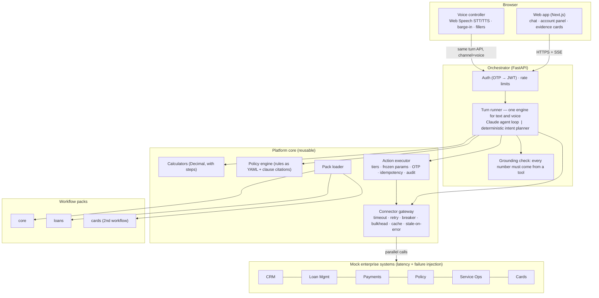

# Architecture — Northstar loan servicing assistant

A text and voice assistant for a (fictional) Indian lender. It answers from the customer's own records,
does every calculation in code, cites the policy it applied, and files service requests across five
simulated enterprise systems. All of it runs on a platform core that a second workflow (credit cards)
reuses without changes.

## How a turn works

1. `POST /v1/sessions/{id}/turns` opens an SSE stream. The customer id comes from the JWT; tools never
   take it as a parameter, so no prompt can point a tool at another customer's records.
2. The turn emits `turn.started` and a status line immediately, then plans:
   - **Claude agent loop** (when credentials are present): `claude-opus-5-5` at low effort, streaming, with
     tool definitions generated from the active packs' manifests, a cached system prompt and a per-turn
     session context block (products, loan in focus, amounts and transactions mentioned, pending action,
     whether the last answer was interrupted). Up to 4 tool rounds; independent tools run in parallel.
   - **Deterministic intent planner** (no credentials, or the LLM fails): regex intents declared in each
     pack manifest, most specific match wins, arguments resolved from the text and session memory. It
     calls the same tools and actions and answers with the tools' own deterministic summaries.
3. Tools run through the connector gateway. Composite tools (e.g. `loans_explain_emi_change`) fetch
   records in parallel, ask the policy engine for a decision, run a calculator, and return three things:
   compact data for the model, a card for the screen, and sources (record ids, clause text, calculation
   steps).
4. The **grounding check** extracts every number from the reply and matches it against this turn's tool
   outputs, earlier facts and the customer's own words. Text mode streams first and corrects in place if a
   number is unsupported (rewrite once, else the deterministic template). Voice mode checks each sentence
   before releasing it to speech, so an invented figure is never spoken.
5. Actions are only *proposed* by the model. The executor freezes the parameters under a hash, enforces the
   tier (`read`, `confirm`, `confirm_otp`), files with an idempotency key, reconciles instead of retrying
   when the outcome is unknown, and writes an append-only audit row.

## The reusable capability: workflow packs

A pack is a folder: `manifest.yaml` (systems, tools, actions with tiers, rules, intents, how to list the
customer's products, which composite to warm at login, account-panel hook), `handlers.py` (composites and
action preparers), `rules/*.yaml`, `prompts/system.md`, `evals/golden.yaml`. The core loads packs at
startup, namespaces their tools, generates LLM tool schemas, activates packs per customer
(`applies_when`), and merges their account-panel data.

**Proof:** the credit card pack (`backend/packs/cards/`) adds one system definition, 4 primitive tools,
2 composites, 1 action, 2 rule files, a prompt fragment and 8 golden questions, and needed **no change
under `backend/src/`**. It reuses the gateway, policy engine, citations, action executor, session memory,
grounding, voice, the generic card UI and the eval runner. Rohan (persona C1004) has a loan and a card and
gets both packs in one conversation. Its size: `handlers.py` 226 lines, `manifest.yaml` 102 lines.

## Measured results

All in `docs/` — rerun with `make eval`, `make bench`, `make load`.

| Evidence | Result |
|---|---|
| Backend tests (`pytest`) | 58 passed: calculators (hand-worked + Hypothesis invariants), policy coverage, gateway retry/timeout/breaker/stale-cache, grounding, security (cross-customer, injected arguments, idempotency, append-only audit), all 5 journeys through the API, the LLM loop against a scripted fake |
| Web tests | 11 unit tests (voice utilities, SSE parser), typecheck and lint clean, production build |
| Golden-set eval (42 cases, 3 packs, deterministic planner, realistic chaos) | **42/42**, figure accuracy **1.0**, 0 grounding replacements — `docs/evals/latest.md` |
| Load: 1,000 concurrent sessions, 4 min, LLM stubbed at 400 ms + 600 ms | **9,492 turns, 0 failures**, ≈40 turns/s on one orchestrator process (laptop). First answer token p50 **410 ms**, p95 1.0 s, p99 2.0 s (400 ms of it is the simulated model) — `docs/perf/load-1000-users_stats.csv` |
| Journey benchmark, cold cache, realistic backends | First answer token p50 120–873 ms, p95 0.66–2.2 s depending on journey (Payments is the slow system by design) — `docs/perf/journeys-fallback-cold.md` |
| Journey benchmark, "bad day" (Payments down, Service Ops 3 s) | Every turn completed; Payments-dependent turns degrade with a stated reason; the breaker short-circuits Payments; statement filing p95 8 s because Service Ops is slow |

Not yet measured: latency with the real Claude planner (no API key was available while building), and
voice timings in a real browser with a microphone (the voice controller was verified in headless Chromium
with a scripted speech shim). Both are recorded automatically once run: `turn.first_token`, `llm.ttft`, and
the client-side `voice.eos_to_first_audio` / `voice.bargein_stop` metrics on `/latency`.

## Decisions and trade-offs

| Decision | Why | Cost |
|---|---|---|
| Math in calculators, model only explains | Exact, testable figures; the grounding check can verify them | Each new question type needs a calculator or composite |
| Policy as YAML rules, clause text only cited | Deterministic eligibility and charges with a citation | Someone owns encoding the rules |
| Composite tools per question family | One tool call answers most questions: fewer LLM rounds, lower latency | Less open-ended than primitives alone (the primitives exist and are easy to expose) |
| Deterministic planner as a first-class fallback | The product keeps working when the LLM is slow, down or absent; doubles as the eval baseline | Regex intents are brittle outside the golden phrasings |
| Grounding check on every reply; sentence-level in voice | No unverified number is shown or spoken | A correct but unseen number (e.g. a sum the model did itself) gets replaced |
| Browser Web Speech for voice | Works with no accounts or keys; same turn API as text | Chrome-only, quality varies; see the production path |
| Login prefetch + short-TTL cache + stale-on-error | First questions answered from cache; Payments outages degrade instead of failing | Cache can be minutes old (shown with its as-of time) |
| SQLite and an in-process store by default; Redis via `REDIS_URL` | Zero setup locally | One orchestrator process unless Redis is set |

## Deviations from the original design

- **Voice**: built on the browser's Web Speech API instead of LiveKit + Deepgram + Cartesia, so it runs with
  no accounts. The server side is transport-agnostic (`channel: "voice"`, sentence gating, cancel endpoint,
  speculative prefetch endpoint), so a LiveKit worker would call the same API. Not built: telephony, server
  STT/TTS.
- **Default planner model**: `claude-opus-5-5` at `low` effort (configurable `MODEL_PLANNER`), instead of
  Sonnet 5.5. Server-side refusal fallback is on by default.
- **Storage**: SQLite (+ optional Redis) instead of Postgres + pgvector; clause search is BM25 instead of
  hybrid vector search (≈15 clauses).
- **Telemetry**: spans are recorded to SQLite with OpenTelemetry-style names and served on `/latency`; no
  OTel collector or Jaeger.
- **Access token**: 1 hour, no refresh endpoint.
- **Docker Compose**: written but not run here (no Docker daemon on the build machine). The local `make up`
  path is the verified one.
- **Platform change made while building the 2nd workflow**: intent matching was changed to "most specific
  match wins" before the card pack was written, because two packs can claim the same words ("statement").
  After that the card pack needed no core changes.

## Production path

Postgres + Redis + OTel collector; orchestrator as stateless replicas (sessions in Redis) behind a load
balancer; LiveKit (or SIP trunk) voice workers calling the same turn API; real OTP/SMS; RS256 tokens with
refresh; secrets in a vault; per-system rate limits agreed with system owners; writes through a queue;
model routing (Haiku for fillers and the cached fast path) and prompt caching tuned with the spans already
recorded.
