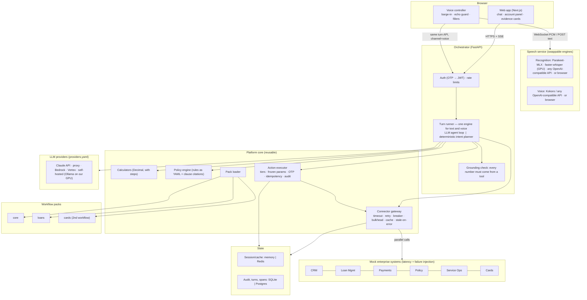

# Architecture — Northstar loan servicing assistant

A text and voice assistant for a (fictional) Indian lender with about 2 million customers and 100,000
support interactions a day. It answers from the customer's own records, does every calculation in code,
cites the policy it applied, and files service requests across six simulated enterprise systems. All of it
runs on a platform core that a second workflow (credit cards) reuses without changes, and every
infrastructure piece behind it (model, speech, storage, systems) is an adapter chosen by configuration.

Interactive version of this page, with a load simulator: see the link in the README.

## How a turn works

1. `POST /v1/sessions/{id}/turns` opens an SSE stream. The customer id comes from the JWT; tools never
   take it as a parameter, so no prompt can point a tool at another customer's records.
2. The turn emits `turn.started` and a status line immediately, then plans:
   - **LLM agent loop** (when a provider is configured): Claude Haiku 5.5 at low effort by default (failover to
     Opus 5.5 on capacity errors, runtime swap via `PUT /v1/admin/model`), streaming, with
     tool definitions generated from the active packs' manifests, a cached system prompt and a per-turn
     session context block (products, loan in focus, amounts and transactions mentioned, pending action,
     whether the last answer was interrupted). Up to 4 tool rounds; independent tools run in parallel.
   - **Deterministic intent planner** (no credentials, or the LLM fails): regex intents declared in each
     pack manifest, most specific match wins, arguments resolved from the text and session memory. It
     calls the same tools and actions and answers with the tools' own deterministic summaries.
3. Tools run through the connector gateway. Composite tools (e.g. `loans_explain_emi_change`) fetch
   records in parallel, ask the policy engine for a decision, run a calculator, and return three things:
   compact data for the model, a card for the screen, and sources (record ids, clause text, calculation
   steps).
4. The **grounding check** extracts every number from the reply and matches it against this turn's tool
   outputs, earlier facts and the customer's own words. Text mode streams first and corrects in place if a
   number is unsupported (rewrite once, else the deterministic template). Voice mode checks each sentence
   before releasing it to speech, so an invented figure is never spoken.
5. Actions are only *proposed* by the model. The executor freezes the parameters under a hash, enforces the
   tier (`read`, `confirm`, `confirm_otp`), files with an idempotency key, reconciles instead of retrying
   when the outcome is unknown, and writes an append-only audit row.

## The reusable capability: workflow packs

A pack is a folder: `manifest.yaml` (systems, tools, actions with tiers, rules, intents, how to list the
customer's products, which composite to warm at login, account-panel hook), `handlers.py` (composites and
action preparers), `rules/*.yaml`, `prompts/system.md`, `evals/golden.yaml`. The core loads packs at
startup, namespaces their tools, generates LLM tool schemas, activates packs per customer
(`applies_when`), and merges their account-panel data.

**Proof:** the credit card pack (`backend/packs/cards/`) adds one system definition, 4 primitive tools,
2 composites, 1 action, 2 rule files, a prompt fragment and 8 golden questions, and needed **no change
under `backend/src/`**. It reuses the gateway, policy engine, citations, action executor, session memory,
grounding, voice, the generic card UI and the eval runner. Rohan (persona C1004) has a loan and a card and
gets both packs in one conversation. Its size: `handlers.py` 226 lines, `manifest.yaml` 102 lines.

## Measured results

All in `docs/` — rerun with `make eval`, `make bench`, `make load`.

| Evidence | Result |
|---|---|
| Backend tests (`pytest`) | 75 passed: calculators (hand-worked + Hypothesis invariants), policy coverage, gateway retry/timeout/breaker/stale-cache, grounding, security (cross-customer, injected arguments, idempotency, append-only audit, dev secrets refused outside demo mode), all 5 journeys through the API, the LLM loop against a scripted fake (failover, swap, promise-without-tool), provider config, both database backends (SQLite here; Postgres 16 when `TEST_PG_URL` is set) |
| Speech and web tests | Speech service 8 (endpointer, recorded utterances, engines, TTS endpoint); web 15 unit tests (voice utilities, SSE parser), typecheck and lint clean |
| Golden-set eval, 46 cases, 3 packs, realistic chaos | Deterministic planner **46/46**, figure accuracy 1.0 (`docs/evals/latest.md`). Claude Haiku 5.5 **46/46**, figure accuracy 1.0, first token p50 2.0 s / p95 3.1 s (`docs/evals/claude-haiku-5-5.md`). Self-hosted Qwen3 14B on an RTX 3090: **40/46**, turn p50 7.7 s (`docs/evals/selfhosted-qwen3-14b.md`) |
| Held-out set, 17 reworded questions (Hinglish, negations, two-part, typos) written after the intents and never used to tune them | Deterministic planner **12/17**; Claude Haiku 5.5 **16/17**, figure accuracy 1.0. The gap is why the LLM is the primary planner and the regex intents only the fallback (`docs/evals/heldout-*.md`) |
| Load: 1,000 concurrent sessions, 4 min, LLM stubbed at 400 ms + 600 ms | **9,455 turns, 0 failures**, ≈40 turns/s on one orchestrator process (laptop). First answer token p50 **410 ms**, p95 1.0 s, p99 2.0 s (400 ms of it is the simulated model) — `docs/perf/load-1000-users_stats.csv` |
| Journey benchmark, cold cache, realistic backends | Deterministic planner: first answer token p50 120–873 ms, p95 0.66–2.2 s depending on journey (Payments is the slow system by design) — `docs/perf/journeys-fallback-cold.md`. Claude Haiku 5.5 planner, 3 runs per journey: all 36 turns completed, first answer token p50 2.1–4.0 s, p95 2.8–4.9 s; the dispute journey is slowest (two tool rounds plus a slow Payments call) — `docs/perf/journeys-claude-haiku-5-5-cold.md` |
| Journey benchmark, "bad day" (Payments down, Service Ops 3 s) | Every turn completed; Payments-dependent turns degrade with a stated reason; the breaker short-circuits Payments; statement filing p95 8 s because Service Ops is slow |
| Speech recognition per utterance (2–4 s question) | Parakeet TDT 0.6B on the Mac (M4, MLX): 130–250 ms. faster-whisper large-v3-turbo on the RTX 3090 over Tailscale: ~280 ms. Whisper large-v3-turbo on the Mac: ~1.05 s, which is why Parakeet is the Mac default |
| Server voice per sentence | Kokoro-82M on the RTX 3090 over Tailscale: 300–380 ms for a 90-character sentence; sentences are fetched in parallel and played in order |

Voice timings in the browser (end of speech → first audio, barge-in → audio stopped, server synthesis per
sentence) are recorded live from real sessions and shown on `/latency` (`voice.eos_to_first_audio`,
`voice.bargein_stop`, `voice.tts_synth`).

## Swappable modules

Every infrastructure piece sits behind a small interface and is chosen by configuration, so a module can move
to a cloud service or a self-hosted alternative without touching the turn logic, the packs or the UI.

| Module | Chosen by | Implemented and exercised | Wired, not exercised here | Interface |
|---|---|---|---|---|
| Planner LLM | `LLM_PROVIDER` + `backend/src/orchestrator/providers.yaml` (add a provider without code) | Anthropic API; Anthropic-compatible proxy; **self-hosted Qwen3 via Ollama on our RTX 3090** | Claude on Bedrock, Claude on Vertex (no cloud account on the build machine) | Anthropic Messages API, streaming + tools |
| Planner fallback | `LLM_MODE` | Deterministic intent planner from pack manifests | | same tools and actions |
| Speech recognition | `ASR_ENGINE` on the speech service; `NEXT_PUBLIC_STT_URL` in the web app | Parakeet-MLX (Mac), **faster-whisper on CUDA (RTX 3090)**, browser Web Speech | Any OpenAI-compatible transcription API (OpenAI, Groq, a self-hosted server): unit-tested against a mock | `transcribe(audio) -> (text, ms)` behind one WebSocket protocol |
| Assistant voice | `TTS_ENGINE` on the speech service; `NEXT_PUBLIC_TTS_URL` in the web app | Browser speechSynthesis; **Kokoro on the RTX 3090** via the OpenAI-compatible speech API | OpenAI TTS (same adapter) | `Speaker` in `web/lib/speech-output.ts`; per-sentence fallback to the browser |
| Session and cache store | `REDIS_URL` | In-process; Redis | ElastiCache, Memorystore (Redis protocol) | `get/set/delete/incr` with TTL |
| Audit, turns, spans | `APP_DB` / `APP_DB_URL` | SQLite; **Postgres 16** (same tests, append-only trigger included) | RDS, Cloud SQL | `execute/query/audit/save_turn` |
| Enterprise systems | `<SYSTEM>_URL` per system, HTTP specs in pack manifests | Mock CRM, Loan Mgmt, Payments, Policy, Service Ops, Cards with chaos | Real systems behind the same gateway (timeouts, retries, breaker per system) | HTTP + `x-service-token` |
| Workflows | `PACKS_DIR`, a folder per pack | core, loans, cards | | manifest + handlers + rules + evals |
| Policy search | `POLICY_URL` | BM25 over clauses in the Policy service | a vector or hybrid search service | `POST /policy/search` |

What is deliberately *not* swappable: the calculators, the policy engine, the grounding check and the action
executor. They are the product's guarantees, so they stay in code with tests rather than behind configuration.

## Scale: 2 million customers, 100,000 interactions a day, 1,000 concurrent conversations

| Quantity | Working figure | How |
|---|---|---|
| Daily turns | ~500,000 | 100,000 interactions × ~5 turns |
| Peak concurrency | ~500 (target headroom: 1,000) | ~10% of the day in the peak hour × ~3 min per conversation |
| Turn rate at 1,000 concurrent | ~50 turns/s | one turn every ~20 s per conversation (listen, think, speak) |
| Orchestrator | 2 processes at 1,000 concurrent; run 3–4 replicas | measured ~40 turns/s per process with the model stubbed (the work is I/O-bound: SSE, connector calls) |
| Enterprise systems | ~90 live calls/s in total, Loans the busiest at ~40/s | measured ~6.1 connector calls per turn (Loans 2.7, Cards 1.3, Payments 0.9, Policy 0.7, CRM 0.4); 26% served from cache on a cold start, 83% once warm; ~70% assumed |
| LLM | ~80 requests/s at 1,000 concurrent; ~$165 a day for 500,000 turns on Haiku 5.5 | ~1.6 model calls per turn, ~4k input tokens (3k of them cached), ~150 output tokens; list prices |
| Speech | GPU or managed STT/TTS sized to ~50 utterances/s | decode ~0.1–0.3 s per utterance unbatched; batching or a managed service in production |

What has to change to get there, in order: sessions in Redis and the platform DB on Postgres (both done, by
configuration); orchestrator replicas behind a load balancer with SSE affinity only for the open stream;
per-system concurrency limits agreed with the system owners (the bulkheads already enforce them per process);
the LLM provider's rate limits sized for ~5,000 requests a minute with failover to a second model; voice moved
to telephony/WebRTC workers that call the same turn API.

## Decisions and trade-offs

| Decision | Why | Cost |
|---|---|---|
| Math in calculators, model only explains | Exact, testable figures; the grounding check can verify them | Each new question type needs a calculator or composite |
| Policy as YAML rules, clause text only cited | Deterministic eligibility and charges with a citation | Someone owns encoding the rules |
| Composite tools per question family | One tool call answers most questions: fewer LLM rounds, lower latency | Less open-ended than primitives alone (the primitives exist and are easy to expose) |
| Deterministic planner as a first-class fallback | The product keeps working when the LLM is slow, down or absent; doubles as the eval baseline; answers several read-only questions in one message in parallel; never proposes an action the customer negated | Regex intents are brittle outside the golden phrasings: 12/17 on the held-out set |
| Grounding check on every reply; sentence-level in voice | No unverified number is shown or spoken | A correct but unseen number (e.g. a sum the model did itself) gets replaced |
| Speech as a separate, swappable service | On-device Parakeet on a Mac, a GPU box, or a cloud API behind one protocol; the browser's own recogniser and voice as the zero-setup fallback | One more process; the browser fallback is Chrome-only and varies in quality |
| Providers and engines as configuration | Cloud or self-hosted per module, chosen at deploy time; the evals run against any of them | Config can name a combination nobody has tested; `/readyz` reports what is active and warns on substitutions |
| Login prefetch + short-TTL cache + stale-on-error | First questions answered from cache; Payments outages degrade instead of failing | Cache can be minutes old (shown with its as-of time) |
| SQLite and an in-process store by default; Postgres and Redis by URL | Zero setup locally, managed services in production | One orchestrator process unless Redis is set |
| Demo mode off unless asked for | On-screen OTP codes and chaos controls never reach a shared deployment by accident; the API refuses to start outside demo mode with the repo's development secrets | `make up` and `.env.example` turn it on for local demos |

## Deviations from the original design

- **Voice**: our own speech service (Parakeet on the Mac, faster-whisper and Kokoro on a GPU box) plus the
  browser's speech as fallback, instead of LiveKit + Deepgram + Cartesia, so it runs with no accounts. The
  server side is transport-agnostic (`channel: "voice"`, sentence gating, cancel endpoint, speculative prefetch
  endpoint), so a LiveKit or telephony worker would call the same API. Not built: telephony.
- **Default planner model**: Claude Haiku 5.5 at `low` effort with Opus 5.5 as failover (configurable,
  swappable at runtime), instead of Sonnet 5.5: it passes the full golden set at a fraction of the cost.
- **Storage**: SQLite by default with Postgres by URL; no pgvector. Clause search is BM25 instead of hybrid
  vector search (≈15 clauses).
- **Telemetry**: spans are recorded to SQLite with OpenTelemetry-style names and served on `/latency`; no
  OTel collector or Jaeger.
- **Access token**: 1 hour, no refresh endpoint.
- **Docker Compose**: written but not run here (no Docker daemon on the build machine). The local `make up`
  path is the verified one.
- **Platform change made while building the 2nd workflow**: intent matching was changed to "most specific
  match wins" before the card pack was written, because two packs can claim the same words ("statement").
  After that the card pack needed no core changes.

## Production path

Postgres and Redis (already selectable) + OTel collector; orchestrator as stateless replicas (sessions in Redis) behind a load
balancer; LiveKit (or SIP trunk) voice workers calling the same turn API; real OTP/SMS; RS256 tokens with
refresh; secrets in a vault; per-system rate limits agreed with system owners; writes through a queue;
model routing (Haiku for fillers and the cached fast path) and prompt caching tuned with the spans already
recorded.
