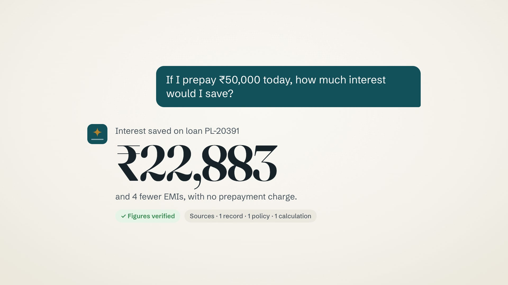

# Northstar — AI loan servicing assistant

A working proof of concept: customers chat or talk to an assistant that answers from their own loan and
card records, shows the evidence behind every figure, and files service requests (prepayment, dispute,
foreclosure, statement) with confirmation and OTP. Built on a reusable platform core; credit cards are a
second workflow added as a pack. Every infrastructure piece (LLM, speech, storage, enterprise systems) is
an adapter you can point at a cloud service or your own hardware.

## Start here

| | |
|---|---|
| **Demo video** (60 s) | https://vishalan.com/northstar-loan-assistant/demo/ (file: [docs/demo/northstar.mp4](docs/demo/northstar.mp4)) |
| **Interactive architecture**, swappable modules and a load simulator for 1,000 concurrent conversations | https://vishalan.com/northstar-loan-assistant/arch/ (source: [docs/arch/index.html](docs/arch/index.html); mirror: https://claude.ai/artifact/H3BRFCgnS9ZAsyuzPyfknH) |
| **Architecture write-up**: decisions, trade-offs, scale, production path | [ARCHITECTURE.md](ARCHITECTURE.md) |
| **Latency and performance** measurements, with the report behind each number | [docs/performance.md](docs/performance.md) |
| **Run it locally** (no keys needed) | `make install && make up`, then open http://localhost:3000 ([details below](#run-it-no-keys-needed)) |
| Live latency while it runs | http://localhost:3000/latency |
| Self-hosted models on a GPU box | [deploy/selfhosted/README.md](deploy/selfhosted/README.md) |
| API and event contract | [docs/api-contract.md](docs/api-contract.md) |

[](https://vishalan.com/northstar-loan-assistant/demo/)

## Run it (no keys needed)

Requirements: [uv](https://docs.astral.sh/uv/) and Node 20+. Chrome for voice.

```bash
cp .env.example .env          # optional; defaults work
make install                  # uv sync + npm ci
make up                       # mocks :8100, orchestrator :8000, web :3000 (+ speech :8200 on Apple Silicon)
open http://localhost:3000    # pick a demo customer; the OTP is shown on screen
make stop
```

Or run them in separate terminals: `make mocks`, `make api`, `make web`, and on Apple Silicon `make speech`.
With Docker: `docker compose up --build` (written, not verified on the build machine).

`make up` runs in demo mode (on-screen OTP codes, persona picker, chaos controls). Outside demo mode the API
refuses to start until `JWT_SECRET`, `ADMIN_TOKEN` and `SERVICE_TOKEN` are set to real values.

### Model providers

With no keys the orchestrator uses its built-in rule-based planner, which handles the demo journeys. To use a
model, set these in `.env` and restart (`make stop && make up`):

| Provider | Settings in `.env` |
|---|---|
| Claude, Anthropic API | `ANTHROPIC_API_KEY=...` (Claude Haiku 5.5 by default, Opus 5.5 as failover) |
| Claude on AWS Bedrock | `LLM_PROVIDER=bedrock`, `BEDROCK_MODEL=<Bedrock model id>`, AWS credentials as usual, `AWS_REGION` |
| Claude on Google Vertex AI | `LLM_PROVIDER=vertex`, `VERTEX_MODEL=<Vertex model id>`, `ANTHROPIC_VERTEX_PROJECT_ID`, `CLOUD_ML_REGION` |
| Self-hosted open model (Ollama) | `ollama pull qwen3:14b`, then `LLM_PROVIDER=selfhosted`, `SELFHOSTED_LLM_URL=http://localhost:11434` (`SELFHOSTED_MODEL` to pick another model) |
| Any Anthropic-compatible endpoint (gateway, proxy, vLLM, LiteLLM) | add an entry to `backend/src/orchestrator/providers.yaml` with its URL and key variable, then `LLM_PROVIDER=<name>` |

`GET http://localhost:8000/readyz` shows the active provider and model; `PUT /v1/admin/model` swaps the model at
runtime. Bedrock and Vertex are wired through the official SDK clients but were not run here (no cloud account on
the build machine). All settings, with comments: [.env.example](.env.example).

**Speech.** On Apple Silicon, `make up` also starts the speech service (`speech/`, port 8200), which runs
NVIDIA's Parakeet TDT 0.6B v3 on device via MLX: 130–250 ms to transcribe a question, nothing sent to a cloud.
The voice bar shows "On-device recognition" when it is used; without it the app falls back to Chrome's
recogniser and voice. The same service runs faster-whisper on an NVIDIA GPU, or forwards to any
OpenAI-compatible speech API, and can serve a server-side voice (`TTS_ENGINE`, `NEXT_PUBLIC_TTS_URL`).

## Self-hosted models on our GPU box (live demo only)

Anyone can run the planner on their own machine with Ollama (see [Model providers](#model-providers)). We also
run every model on our own GPU box: Qwen3 14B through Ollama as the planner, faster-whisper
large-v3-turbo for recognition and Kokoro for the voice, on an RTX 3090 (24 GB, power-capped at 300 W) with a
Ryzen 5 3600X and 62 GB RAM. It is reached over **Tailscale**, so this mode only works from a machine on that
tailnet. It is shown in the live demo; anyone else runs the default setup above.

```bash
make selfhosted-check   # LLM and speech on the GPU box reachable?
make selfhosted         # mocks + API + web here; planner, recognition and voice on the GPU box
```

Measured: recognition ~280 ms per question and voice 300–380 ms per sentence over Tailscale; the 14B
planner passes 40 of 46 golden questions at a 7.7 s median turn. That's why the default stays Claude with the
deterministic fallback. Setup, specifications and the trade-off in full:
[deploy/selfhosted/README.md](deploy/selfhosted/README.md).

## Demo customers and journeys

| Customer | Try |
|---|---|
| Priya Sharma | "My EMI increased this month. Why?" → "If I prepay ₹50,000 today, how much interest would I save?" → "Go ahead, reduce my tenure" (OTP) |
| Priya (voice) | Mic → "What's my next EMI?" → interrupt: "Actually, check my last payment first" → "Would paying ₹20,000 extra reduce my tenure?" |
| Arjun Mehta | "Show me the payments that failed in the last six months" → "Raise a dispute for the duplicate charge" |
| Kavya Iyer | "Am I eligible for foreclosure without a penalty?" → "What are my options?" → "Send me a statement" |
| Rohan Das | "Why is my card statement higher this month?" → "Dispute the ₹4,299 charge" (credit card pack) |

Add `?demo=1` to the URL for the chaos controls (calm / realistic / bad day). `/latency` shows measured
latency per stage, per system and per voice step; `/evals` shows the last golden-set run.

## Tests and evidence

```bash
make test     # backend pytest (79), speech service (8, Apple Silicon), web unit tests (15), typecheck, lint
make eval     # golden set: 46 questions across 3 packs -> docs/evals/latest.md
make eval-heldout  # 17 reworded questions (Hinglish, negations, two-part, typos) never used to tune the intents
make bench    # journey latency, cold cache, realistic and bad-day backends -> docs/perf/
make load     # 1,000 concurrent sessions (start the API with LLM_MODE=stub TURN_RATE_LIMIT=100000)
```

All measurements, with the report behind each one: [docs/performance.md](docs/performance.md).

Run the eval against any provider: `LLM_MODE=llm LLM_PROVIDER=<name> uv run python evals/run.py` in `backend/`.

## Layout

```
backend/
  src/nsplatform/   platform core: connector gateway, calculators, policy engine, action executor, pack loader,
                    store (memory | Redis), database (SQLite | Postgres)
  src/orchestrator/ API, turn runner (LLM agent loop + deterministic planner), grounding check, LLM providers
  src/mocks/        CRM, Loan Mgmt, Payments, Policy, Service Ops, Cards — seeded data + chaos injection
  packs/            core, loans, cards — manifest, handlers, rules, prompts, golden evals
  tests/ evals/ bench/ loadtest/
speech/             speech service: recognition and voice engines behind one WebSocket protocol
web/                Next.js app: chat, voice, account panel, requests, latency, evals
deploy/selfhosted/  GPU box stack (speech on CUDA, Kokoro) reached over Tailscale
docs/               performance.md, API contract, eval and performance reports, demo video, screenshots
```

All data is synthetic. Northstar Finance is fictional.
