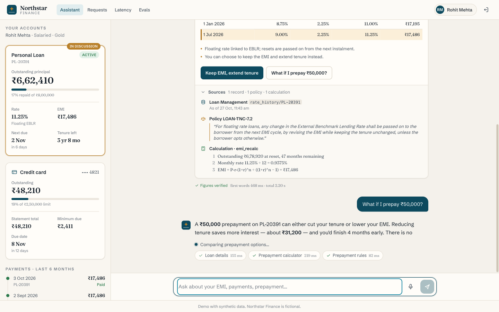

# Northstar Finance: customer web app

The customer-facing web app for the loan-servicing assistant proof of concept. It is built with Next.js 15 (App Router), React 19, TypeScript, Tailwind CSS v4 and Zustand. It talks to the orchestrator described in [`../docs/api-contract.md`](../docs/api-contract.md).



## Run

```bash
cd web
npm install
NEXT_PUBLIC_API_URL=http://localhost:8000 npm run dev      # http://localhost:3000
```

`NEXT_PUBLIC_API_URL` defaults to `http://localhost:8000`. It is inlined at build time, so set it before `npm run build` when you build for production:

```bash
NEXT_PUBLIC_API_URL=https://api.example.com npm run build && npm start
```

### Without the backend (mock API)

`scripts/mock-api.mjs` is a dependency-free Node server. It implements the whole contract with canned data: personas, OTP, sessions, streamed SSE turns, actions, overview, requests, metrics, chaos and evals.

```bash
npm run mock                                            # http://localhost:8787
NEXT_PUBLIC_API_URL=http://localhost:8787 npm run dev
```

- The login OTP is shown in the demo banner (`246810`), and the action OTP is `123456`, also shown on the confirm card.
- The text of a question picks the scenario. "EMI" gives the EMI-change card. "prepay" gives a comparison with `columns` plus an OTP action. "failed / bounce / charge" gives a payments table with a `bad` row plus a confirm action. "statement" gives a statement request.
- `SPEED=0.25 npm run mock` streams 4x faster, and `PORT=9000` changes the port.

## Scripts

| Command | What it does |
|---|---|
| `npm run dev` | Dev server on :3000 |
| `npm run build` / `npm start` | Production build / serve |
| `npm run lint` | ESLint (next/core-web-vitals + TypeScript) |
| `npm run typecheck` | `tsc --noEmit` |
| `npm test` | Unit tests for `lib/voice-utils.ts` and the SSE parser, using `node --test` (Node ≥ 22.6 strips TypeScript natively) |
| `npm run mock` | Mock API on :8787 |

## Screens

- `/login` lets you pick a persona, then sign in with an OTP. Clicking the demo-code banner fills the code and verifies it.
- `/` is the main screen. On the left is the account panel (a drawer on mobile), which highlights the product named by `focus` and refetches after each `turn.completed` or action. The centre is the streaming conversation, with a live tool-progress line, one generic `CardView` for every card type, an `ActionCard` for confirm and OTP actions, suggestion chips, the composer and voice mode.
- `/requests` lists service requests. Statement requests get a Download link (`?token=`).
- `/latency` shows per-stage, per-system and client-side voice/text metrics, plus recent turns. It refreshes every 5 s.
- `/evals` shows the latest eval run, or an empty state.
- Demo controls: add `?demo=1` once (it is remembered for the tab) to get a **Demo** button in the top bar. It opens the chaos presets (calm / realistic / bad_day). `?demo=0` hides it.

## Architecture

```
lib/
  api.ts              REST client, token in sessionStorage, error envelope → ApiError, 401 → /login
  sse-parser.ts       pure text/event-stream parser (chunk-safe, CRLF, comments, multi-line data)
  turn-engine.ts      the single in-flight turn: fetch + ReadableStream → parser → store; abort + /cancel
  chat-store.ts       Zustand store (messages, tool progress, attachments, action states, focus, suggestions)
  voice-utils.ts      pure voice helpers (sentence splitter, markdown→speech, backchannel/echo, OTP digits, fillers)
  voice-controller.ts VoiceController state machine on the Web Speech API (deps injected)
  use-voice.ts        React binding (useSyncExternalStore) + wiring to the engine/api
components/           AppShell, AccountPanel, CardView, ActionCard, Conversation, VoiceBar, DemoDrawer, Markdown, OtpInput
```

### Voice mode (Chrome / Edge)

The state machine is `idle → listening → user_speaking → thinking → speaking → listening`, plus `interrupted` on barge-in.

- **Recognition.** Uses `SpeechRecognition` with `continuous`, `interimResults` and `en-IN`. It restarts on `onend` while the call is active. A final result followed by 250 ms with no more interims ends the turn, which is sent with `channel: "voice"`. Interim text is sent to `/prefetch` at most every 400 ms.
- **Speech.** `answer.delta` text is split into sentences as it arrives, and each finished sentence goes to `speechSynthesis` straight away. Markdown is stripped and `₹x` is read as "x rupees". Voice preference is en-IN, then en-GB, then en-US.
- **Fillers.** If no answer text has arrived after 700 ms, the assistant says one filler based on the latest `status`. A second filler ("taking a little longer") plays at 3 s.
- **Barge-in.** An interim result triggers barge-in only if it has at least 2 words, is not just backchannel words, and has no more than 60% overlap with the sentence being spoken. Barge-in calls `speechSynthesis.cancel()`, aborts the fetch, and POSTs `/cancel` with the `spoken_text` so far. The message gets an "Interrupted" tag.
- **Voice confirmation.** After an `action.proposed`, a yes reply confirms a `confirm` action with `via: "voice"`. For `confirm_otp`, the assistant reads 6 digits from the reply ("one two three…", "double five" and plain digits all work).
- **Metrics.** `voice.eos_to_first_audio`, `voice.bargein_stop` and `text.first_token_render` are posted to `/v1/metrics/client`.

If the API is missing, a clear notice explains that voice needs Chrome or Edge. If the microphone permission is denied, the error says how to allow it.
